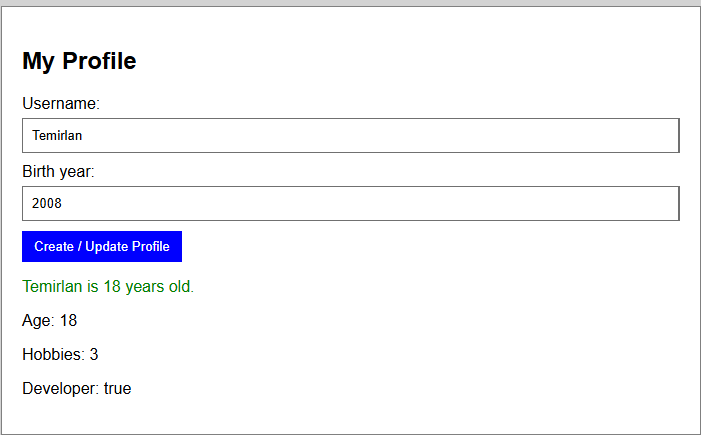
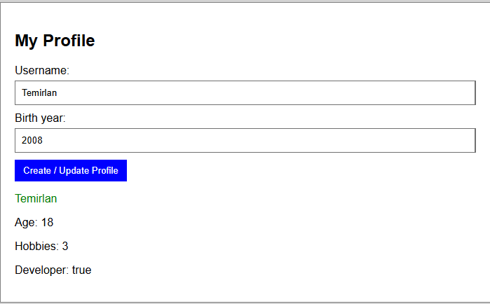
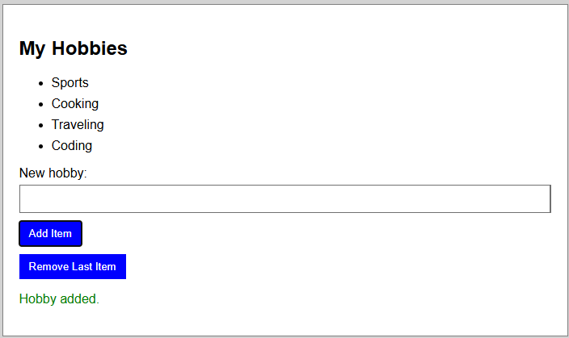

# Assignment 5: JavaScript Basics

Name: Temirlan  
Group: IT-2502

Repository: https://github.com/TemirlanDosDos/assignment55555  
Website: Vercel deployment pending

## What I made

### 1. Profile and JavaScript values

Created a `userProfile` object with a name, birth year, developer status, and hobbies. The script calculates the age from the birth year, counts the hobbies, and displays the profile information on the page.

### 2. Profile form

Added fields for a username and birth year. When the form is submitted, JavaScript reads the entered values, updates the profile object, calculates the age, and displays the updated profile without reloading the page.

### 3. Hobby list

Added a list of hobbies, a text field, and **Add Item** and **Remove Last Item** buttons. The Add button puts the entered hobby into the list. The Remove button deletes the last hobby in the list.

## Screenshots

### Part 1: Profile and JavaScript values

### Part 2: Profile form

### Part 3: Add and remove hobbies

## Result

The page displays profile information, updates it from the form, and lets the user add or remove hobbies.
